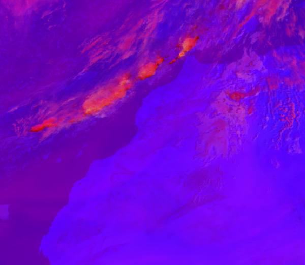
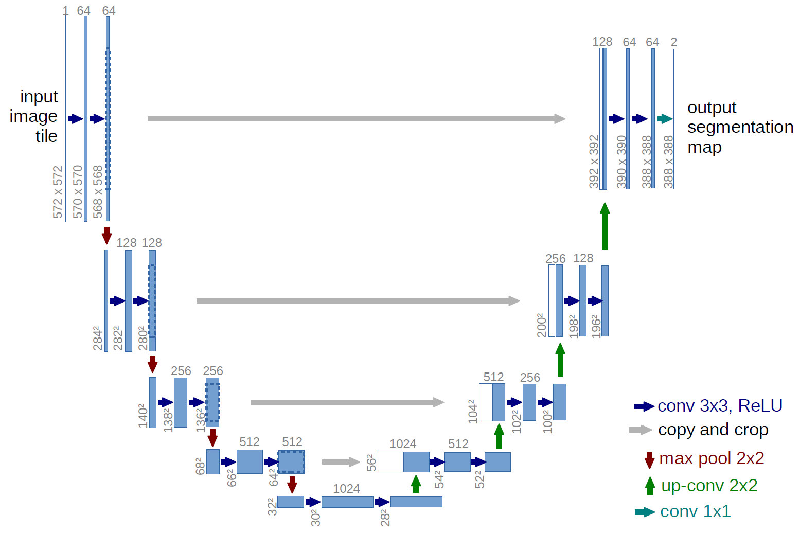
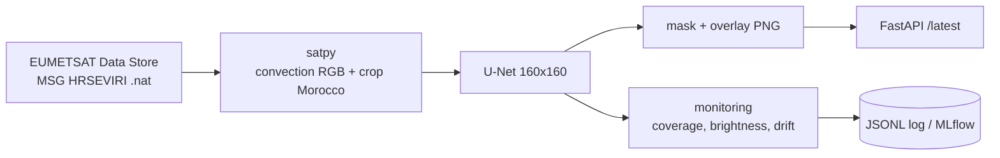

<div align="center">

 &nbsp;&nbsp;&nbsp; 

# 🛰️ Satellite Convection Labeling

**Real-time segmentation of convective clouds over Morocco from MSG/SEVIRI imagery, using a U-Net.**


  

*Convection RGB input · U-Net · 2023 convection-episode map produced by the model*

</div>

---

## Overview

Manually outlining convective systems on satellite images is slow and subjective. This project trains a
**U-Net** to label convection on the EUMETSAT *convection RGB* composite of MSG/SEVIRI over Morocco
(−20°E…5°E, 20°N…40°N), and ships it as a small, monitored, real-time pipeline.

| Composite channel | SEVIRI difference | Highlights |
|---|---|---|
| Red | WV 6.2 − WV 7.3 µm | Upper-level moisture |
| Green | IR 3.9 − IR 10.8 µm | Small ice particles / strong updrafts |
| Blue | NIR 1.6 − VIS 0.6 µm | Cloud-top phase |

Details of the method, the expert labelling protocol and the comparison with an OpenCV/HSV baseline are in
[`docs/report.pdf`](docs/report.pdf).

## Results (2023, 2 552 scenes vs. expert masks)

| Method | Mean IoU | Mean Dice | Pixel acc. |
|---|---|---|---|
| OpenCV baseline | 0.563 | 0.601 | 0.993 |
| **U-Net** | **0.734** | **0.754** | 0.993 |

Computed from [`metrics/metrics_opencv_unet_vs_expert_2023.csv`](metrics/metrics_opencv_unet_vs_expert_2023.csv).
Scenes with no convection in both prediction and expert mask count as a perfect score, so the mean is
flattered by empty scenes; see the notebooks for the per-scene distributions (Bland-Altman, box plots).

## Pipeline



## Repository layout

```
src/convection_seg/   package: satellite, preprocessing, model, realtime, monitoring, evaluate, api, cli
configs/default.yaml  region, model, real-time and monitoring settings
tests/                pytest suite (no TensorFlow needed)
notebooks/            01-05: analysis, training and evaluation notebooks (Colab)
docs/                 report.pdf, main.pdf
fig/                  figures used by the report and this README
metrics/              per-scene OpenCV vs U-Net vs expert metrics
Dockerfile, docker-compose.yml, .github/workflows/ci.yml, Makefile
```

## Quick start

```bash
git clone https://github.com/msaadi15/Satellite_Convection_Labeling.git
cd Satellite_Convection_Labeling
python -m venv .venv && source .venv/bin/activate
pip install -r requirements-dev.txt && pip install -e . --no-deps
```

### Model weights

The checkpoint (`model_all_best.keras`, ~370 MB) is too large for Git. Put it at
`model/model_all_best.keras` (path configurable in `configs/default.yaml`).

### Segment local images

```bash
convseg predict data/image/prod_2023-01-01T12-00-00.000Z.png --out outputs/predict
```

### Real-time segmentation of Morocco

1. Create a free account on the [EUMETSAT Data Store](https://data.eumetsat.int) and export your API key:
   ```bash
   export EUMETSAT_KEY=...  EUMETSAT_SECRET=...      # or JSON file ~/.eumetsat_api_key
   ```
2. Run the loop (one cycle per SEVIRI repeat cycle, 15 min):
   ```bash
   convseg realtime          # or: convseg realtime --once
   ```
   Each cycle downloads the newest scan, builds the convection RGB, segments it and writes
   `outputs/realtime/latest_{rgb,mask,overlay}.png` plus timestamped copies.

### API

```bash
convseg serve                                   # http://localhost:8000/docs
curl -F file=@scene.png "localhost:8000/predict?output=overlay" -o overlay.png
curl localhost:8000/latest -o latest.png        # newest real-time product
curl localhost:8000/stats                       # monitoring records
```

### Docker

```bash
docker compose up --build        # api on :8000 + real-time worker (needs EUMETSAT_KEY/SECRET)
```

## MLOps

| Concern | How |
|---|---|
| Reproducible config | One YAML, any key overridable with `CONVSEG__SECTION__KEY` env vars |
| CI | GitHub Actions: lint (`ruff`), unit tests, Docker build on every push |
| Model quality gate | `convseg evaluate --min-dice 0.5` exits non-zero if mean Dice regresses — usable as a release check |
| Experiment tracking | Set `monitoring.mlflow_enabled: true` to log evaluation runs and per-scene stats to MLflow |
| Production monitoring | Every prediction appends coverage / brightness / probability stats to a JSONL log |
| Drift detection | `convseg make-reference` freezes reference stats; later predictions with \|z\| above the threshold are flagged in the log |
| Deployment | Slim Docker image, weights mounted as a volume, `restart: unless-stopped` worker |

## Tests

```bash
make test      # pytest
make lint      # ruff
```

## Status & limitations

- The real-time path (EUMETSAT download → satpy RGB → U-Net) has been written against the same composite and
  region used for the training images, but needs your EUMETSAT credentials to run end to end; the
  `nat_to_rgb` orientation/cropping should be checked once against a known scene.
- The model works at 160×160 and is upsampled to the image size, so mask edges are coarse.
- Training/evaluation notebooks were written for Google Colab and contain Drive paths.

## Authors

Affiliations (see logos above): EHTP and DGM, Morocco.
Report: [`docs/report.pdf`](docs/report.pdf).
