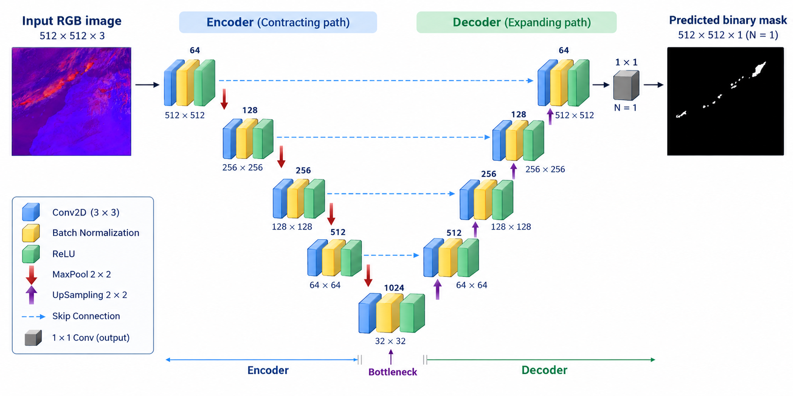
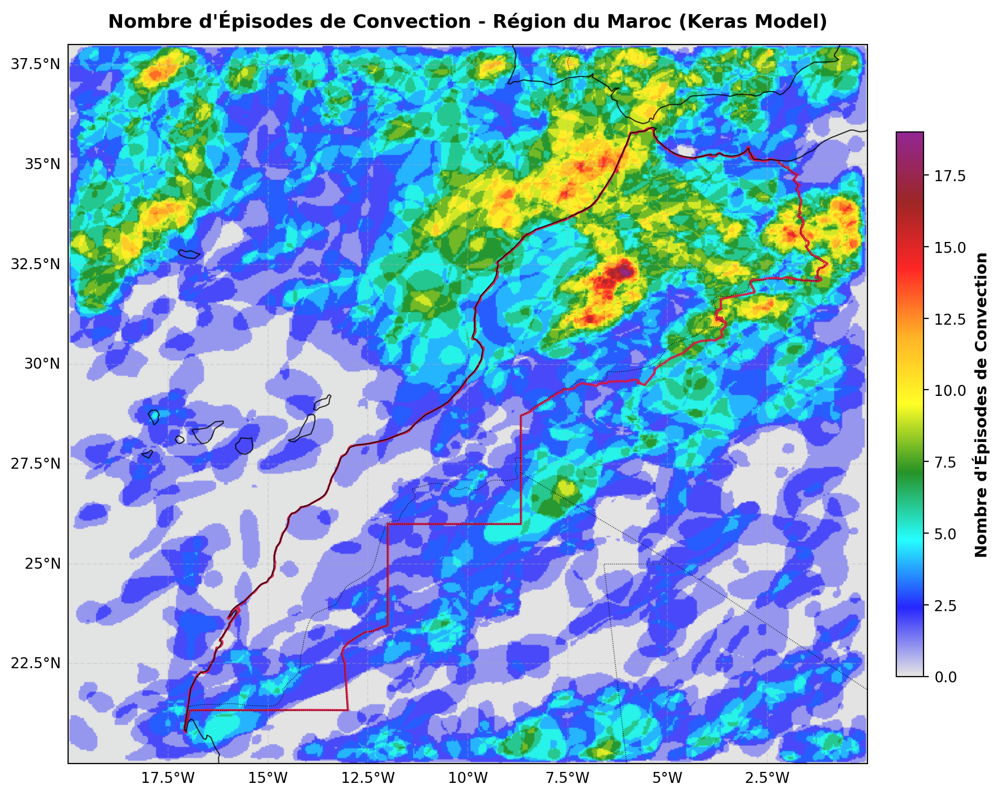
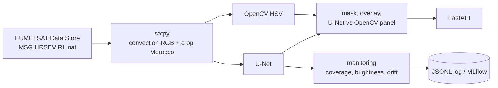

<div align="center">

 &nbsp;&nbsp;&nbsp; 

# 🛰️ Satellite Convection Labeling

**Real-time segmentation of convective clouds over Morocco from MSG/SEVIRI imagery —
a U-Net compared against a classical OpenCV baseline.**


</div>

---

**Contents:**
[1. Overview](#1-overview) ·
[2. Data](#2-data) ·
[3. Methods](#3-methods) ·
[4. Results](#4-results) ·
[5. System](#5-system) ·
[6. Getting started](#6-getting-started) ·
[7. Usage](#7-usage) ·
[8. MLOps](#8-mlops) ·
[9. Repository layout](#9-repository-layout) ·
[10. Limitations](#10-limitations) ·
[11. Authors](#11-authors)

## 1. Overview

Manually outlining convective systems on satellite images is slow and subjective. This project
**compares two ways of segmenting convection automatically** on the SEVIRI convection RGB over Morocco:

1. a **classical OpenCV method** — colour thresholds in HSV space, no training;
2. a **deep-learning U-Net** trained on expert-labelled masks.

Both are evaluated against the expert masks, then packaged as a monitored **real-time** service that
segments every new SEVIRI scan. Full details are in the report: [`docs/report.pdf`](docs/report.pdf).

## 2. Data

- **Satellite:** Meteosat Second Generation (MSG), SEVIRI instrument, full disk every 15 min,
  from the [EUMETSAT Data Store](https://data.eumetsat.int) (collection `EO:EUM:DAT:MSG:HRSEVIRI`).
- **Region:** Morocco, −20°E…5°E and 20°N…40°N.
- **Input image:** the EUMETSAT *convection RGB* composite, where intense convection appears yellow/orange/red:

| Channel | SEVIRI difference | Highlights |
|---|---|---|
| Red | WV 6.2 − WV 7.3 µm | Upper-level moisture |
| Green | IR 3.9 − IR 10.8 µm | Small ice particles / strong updrafts |
| Blue | NIR 1.6 − VIS 0.6 µm | Cloud-top phase |

- **Labels:** expert binary masks (`data/mask_manual/mask_<scene>.png`) for the 2023 scenes.

## 3. Methods

### 3.1 OpenCV baseline (HSV thresholds)

The RGB image is converted to HSV and pixels in the yellow, orange and red hue ranges (saturation and
value ≥ 100) are kept as convection. This is fast and needs no training, but it depends entirely on fixed
colour thresholds. Code: [`src/convection_seg/opencv_baseline.py`](src/convection_seg/opencv_baseline.py).

### 3.2 U-Net

<div align="center">



*Encoder–decoder with skip connections (Conv 3×3 → BatchNorm → ReLU blocks). Input: 512×512×3 convection
RGB image; output: 512×512×1 binary mask, resized back to the original scene size.*

</div>

Trained with binary cross-entropy + Dice loss on the expert masks (see the notebooks in `notebooks/`).
Code: [`src/convection_seg/model.py`](src/convection_seg/model.py).

## 4. Results

Evaluation on 2 552 scenes from 2023 against the expert masks:

| Method | Mean IoU | Mean Dice | Pixel acc. |
|---|---|---|---|
| OpenCV baseline | 0.563 | 0.601 | 0.993 |
| **U-Net** | **0.734** | **0.754** | 0.993 |

The U-Net matches the expert masks clearly better than the colour thresholds. Scenes with no convection in
both the prediction and the expert mask count as a perfect score, which raises both means; per-scene
distributions (Bland-Altman, box plots) are in `notebooks/01_analyse_metrics.ipynb`. Source:
[`metrics/metrics_opencv_unet_vs_expert_2023.csv`](metrics/metrics_opencv_unet_vs_expert_2023.csv).

Counting how many times each pixel was segmented as convection over the year gives the climatology below:
convection concentrates over the Atlas and Rif mountains and the north-east of the country.

<div align="center">



*Number of convection episodes per pixel in 2023, from the U-Net segmentations.*

</div>

## 5. System



Every 15 minutes the newest scan is downloaded, converted to the convection RGB, segmented by both methods,
saved, and its statistics are logged for monitoring.

## 6. Getting started

```bash
git clone https://github.com/msaadi15/Satellite_Convection_Labeling.git
cd Satellite_Convection_Labeling
python -m venv .venv && source .venv/bin/activate
pip install -r requirements-dev.txt && pip install -e . --no-deps
```

**Model weights.** The checkpoint (`model_all_best.keras`, ~370 MB) is too large for Git. Put it at
`model/model_all_best.keras` (path configurable in `configs/default.yaml`).

**EUMETSAT credentials** (only for real-time). Create a free account on the
[EUMETSAT Data Store](https://data.eumetsat.int), get your key/secret at
<https://api.eumetsat.int/api-key>, then:

```bash
export EUMETSAT_KEY=...  EUMETSAT_SECRET=...      # or JSON file ~/.eumetsat_api_key
```

## 7. Usage

### 7.1 Segment local images

```bash
convseg predict data/image/prod_2023-01-01T12-00-00.000Z.png --out outputs/predict
```

### 7.2 Compare U-Net vs OpenCV

```bash
convseg compare data/image/prod_2023-01-01T12-00-00.000Z.png --masks data/mask_manual
convseg opencv data/image outputs/opencv_masks      # OpenCV baseline only
```

`compare` writes a panel *RGB | Expert | U-Net | OpenCV | agreement* (green = both, red = U-Net only,
blue = OpenCV only) and prints IoU/Dice between the methods and against the expert.

### 7.3 Evaluate on the expert masks

```bash
convseg evaluate --images data/image --masks data/mask_manual --out-csv outputs/eval.csv
```

Reports IoU, Dice and accuracy for both methods side by side.

### 7.4 Real-time segmentation of Morocco

```bash
convseg realtime          # one cycle per SEVIRI repeat cycle (15 min); --once for a single cycle
```

Each cycle writes `outputs/realtime/latest_{rgb,mask,overlay,opencv_mask,compare}.png` plus timestamped copies.

### 7.5 API

```bash
convseg serve                                   # http://localhost:8000/docs
curl -F file=@scene.png "localhost:8000/predict?output=compare" -o compare.png   # overlay | mask | opencv | compare
curl localhost:8000/latest -o latest.png        # newest product written by `convseg realtime`
curl localhost:8000/stats                       # monitoring records
# Real-time through the API: every caller uses THEIR OWN EUMETSAT credentials
curl -X POST "localhost:8000/realtime?kind=compare" \
     -H "X-EUMETSAT-Key: <your key>" -H "X-EUMETSAT-Secret: <your secret>" -o realtime.png
```

> `POST /realtime` never uses the server's credentials: each user sends their own key/secret in the
> `X-EUMETSAT-Key` / `X-EUMETSAT-Secret` headers. They are used for that request only and are not stored
> or logged. Put the service behind HTTPS so the headers are encrypted in transit.

### 7.6 Docker

```bash
docker compose up --build        # API on :8000 + real-time worker (needs EUMETSAT_KEY/SECRET)
```

## 8. MLOps

| Concern | How |
|---|---|
| Reproducible config | One YAML, any key overridable with `CONVSEG__SECTION__KEY` env vars |
| CI | GitHub Actions: lint (`ruff`), unit tests, Docker build on every push |
| Model quality gate | `convseg evaluate --min-dice 0.5` exits non-zero if mean Dice regresses — usable as a release check |
| Experiment tracking | Set `monitoring.mlflow_enabled: true` to log evaluation runs and per-scene stats to MLflow |
| Production monitoring | Every prediction logs coverage, brightness, probability and U-Net/OpenCV agreement to a JSONL file |
| Drift detection | `convseg make-reference` freezes reference stats; later predictions with \|z\| above the threshold are flagged |
| Deployment | Slim Docker image, weights mounted as a volume, `restart: unless-stopped` worker |

Run the checks locally with `make test` (pytest) and `make lint` (ruff).

## 9. Repository layout

```
src/convection_seg/   satellite, opencv_baseline, model, comparison, evaluate, realtime, monitoring, api, cli
configs/default.yaml  region, model, real-time and monitoring settings
tests/                pytest suite (no TensorFlow needed)
notebooks/            01-05: analysis, training and evaluation notebooks (Colab)
docs/                 report.pdf, main.pdf
fig/                  figures used by the report and this README
metrics/              per-scene OpenCV vs U-Net vs expert metrics
Dockerfile, docker-compose.yml, .github/workflows/ci.yml, Makefile
```

## 10. Limitations

- The real-time path (EUMETSAT download → satpy RGB → segmentation) uses the same composite and region as
  the training images but needs EUMETSAT credentials to run end to end; the `nat_to_rgb` orientation and
  cropping should be checked once against a known scene.
- Scenes (about 600×521) are resized to the model input and the mask is resized back, so mask edges are
  slightly interpolated. The input size is read from the checkpoint; if it differs from `model.input_size`
  in the config, a warning is logged and the checkpoint's size is used.
- The training and evaluation notebooks were written for Google Colab and contain Drive paths.

## 11. Authors

Affiliations (see logos above): EHTP and DGM, Morocco.
Report: [`docs/report.pdf`](docs/report.pdf).
